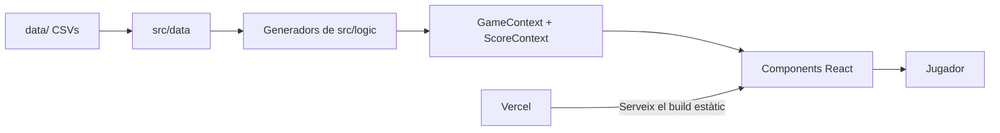

# GeoTest

A browser quiz game on Catalan geography: municipalities, comarques and peaks.

Un joc de geografia catalana per posar a prova els coneixements sobre municipis, comarques i cims.

Juga-hi a [geotest.aleixmorenotelesforo.com](https://geotest.aleixmorenotelesforo.com).

## Què inclou

- **1vs1:** població, altitud i superfície dels municipis.
- **Tests:** capitals de comarca, comarques i províncies.
- **Jocs de mapa:** localitza la comarca i relaciona municipis amb comarques.
- **Muntanyes:** cims i serralades.
- **Mode festa:** variant de joc en grup, per a majors de 18 anys.
- Tres vides per partida, puntuació i rècord.

## Arquitectura



- React 18 amb Create React App i `react-scripts`.
- Els generadors de `src/logic` utilitzen les dades de `src/data` per crear les preguntes.
- `GameContext` i `ScoreContext`, a `src/components/context/`, gestionen l'estat amb React Context.

## Executar-lo en local

```bash
git clone https://github.com/TelesforoAleix/geotest.git
cd geotest
npm install
npm start
```

Obre [http://localhost:3000](http://localhost:3000). Per generar la versió de producció:

```bash
npm run build
```

Per executar els tests:

```bash
npm test
```

## Estructura

```text
src/components/  # Components React i contextos
src/logic/       # Generadors de preguntes
src/data/        # Dades del joc
data/            # CSVs d'origen
public/          # Recursos estàtics
```

## Dades

Fonts: Idescat (municipis, 2023) i Institut Cartogràfic de Catalunya (cims, 2021). CSVs a [data/](./data).
